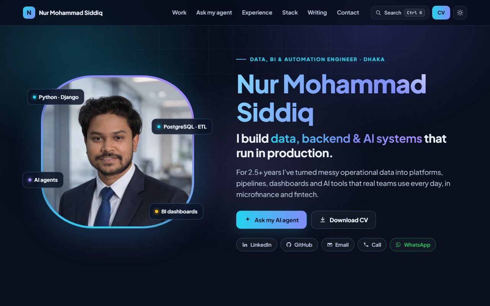
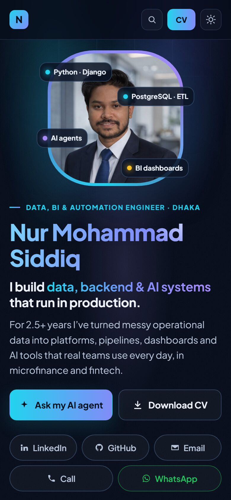

# nurmohammad126641.github.io

[](https://github.com/NurMohammad126641/nurmohammad126641.github.io/actions/workflows/ci.yml)

Source for my portfolio: **https://nurmohammad126641.github.io**

<p align="center">
  
  &nbsp;
  
</p>

## Highlights

- **Ask my AI agent.** Google Gemini answers questions about my work using function calling: it picks tools (`get_profile`, `find_evidence`, `get_projects`, …), a Cloudflare Worker runs them on my real profile data, and Gemini answers only from what they return. The chat shows each tool call. If Gemini is unavailable, a rule-based version of the same agent answers instantly in the browser.
- **It can't make things up.** Every answer is checked before it's shown (see below).
- **Secrets stay secret.** The Gemini API key is a Cloudflare Worker secret, never in this repo or the browser. The Worker only accepts requests from this site and rate-limits each visitor.
- **Phone first.** A bottom tab bar, swipeable cards and a diagram that redraws for small screens, because most visitors arrive from LinkedIn on a phone.
- **No framework, no build step.** Plain HTML, CSS and ES modules, served as static files by GitHub Pages.

## How the agent stays honest

```
question ─► Gemini picks tools ─► tools read js/agent/knowledge.js ─► Gemini answers
                                                                        │
              rule-based agent ◄── blocked twice ◄── guardrail ◄────────┘
              (in the browser)                         │ passes
                                                       ▼
                                             signed answer to the chat
```

1. **Grounded in tools.** The model never answers from memory. It calls tools that read one file of real profile data, the same way my production analytics chatbot works.
2. **A guardrail checks every answer** ([`guard.js`](js/agent/guard.js)). Every email, phone number, link, technology, number and "I built it solo" claim must appear in a tool result. The visitor's own words don't count, so a leading question can't put words in the agent's mouth.
3. **One retry, then a safe fallback.** A blocked answer gets one more try with a stricter rule. If that fails too, the rule-based agent answers in the browser instantly, from the same data.
4. **Signed history.** The Worker signs each answer with HMAC-SHA256, so a visitor can't send back a made-up earlier turn to steer the next answer.
5. **Measured, not assumed.** `npm test` runs 90+ unit tests, and `npm run eval` asks the live agent recruiter-style and adversarial questions from [`evals/cases.js`](evals/cases.js): prompt injection, leading questions, confidential data and off-topic requests.

## Project structure

```
index.html        page markup
css/styles.css    design tokens, components and responsive rules
js/main.js        entry point
js/agent/         the AI agent: knowledge, tools, LLM tool schema, rule-based router, chat window
js/ui/            theme, navigation, command palette, scroll effects
worker/           Cloudflare Worker that calls Gemini and runs the tools
tests/            unit tests for the agent and the Worker (node:test)
evals/            live questions for the deployed agent (npm run eval)
assets/           images, icons and CV
```

## Run locally

```bash
npm install
npm start       # http://localhost:3000
npm test        # agent and Worker unit tests
npm run lint    # formatting check
```

The site works without the Worker (rule-based agent only). To deploy the Worker, add `GEMINI_API_KEY` as a secret in the Cloudflare dashboard, run `npm run deploy:agent`, and set its URL as `AGENT_API_URL` in `js/config.js`.

## License

Code is MIT licensed. The content (text, photos and CV) is © Nur Mohammad Siddiq, all rights reserved.
