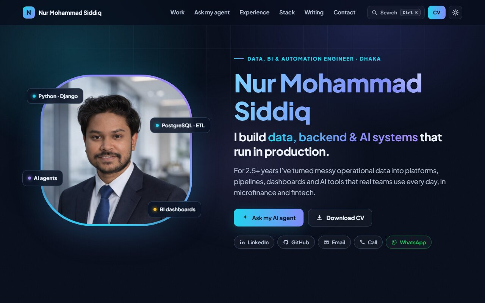
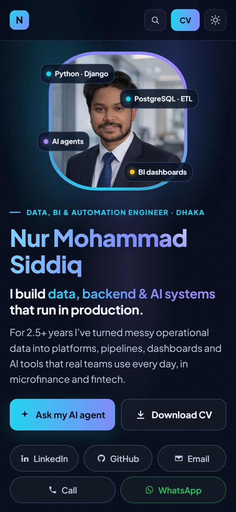

# nurmohammad126641.github.io

[](https://github.com/NurMohammad126641/nurmohammad126641.github.io/actions/workflows/ci.yml)

Source for my portfolio: **https://nurmohammad126641.github.io**

<p align="center">
  
  &nbsp;
  
</p>

## Highlights

- **Ask my AI agent.** An in-browser agent answers questions about my work. It picks one or more tools (`get_profile`, `find_evidence`, `get_projects`, …), calls them, and answers only from what they return, the same function-calling pattern as the analytics chatbot I built at Padakhep. Routing is rule-based so the demo stays instant and free; in production an LLM makes that choice.
- **Phone first.** A bottom tab bar, swipeable cards and a diagram that redraws for small screens, because most visitors arrive from LinkedIn on a phone.
- **No framework, no build step.** Plain HTML, CSS and ES modules, served as static files by GitHub Pages.

## Project structure

```
index.html        page markup
css/styles.css    design tokens, components and responsive rules
js/main.js        entry point
js/agent/         the AI agent: knowledge, tools, router, chat window
js/ui/            theme, navigation, command palette, scroll effects
tests/            unit tests for the agent (node:test)
assets/           images, icons and CV
```

## Run locally

```bash
npm install
npm start       # http://localhost:3000
npm test        # agent unit tests
npm run lint    # formatting check
```

## License

Code is MIT licensed. The content (text, photos and CV) is © Nur Mohammad Siddiq, all rights reserved.
